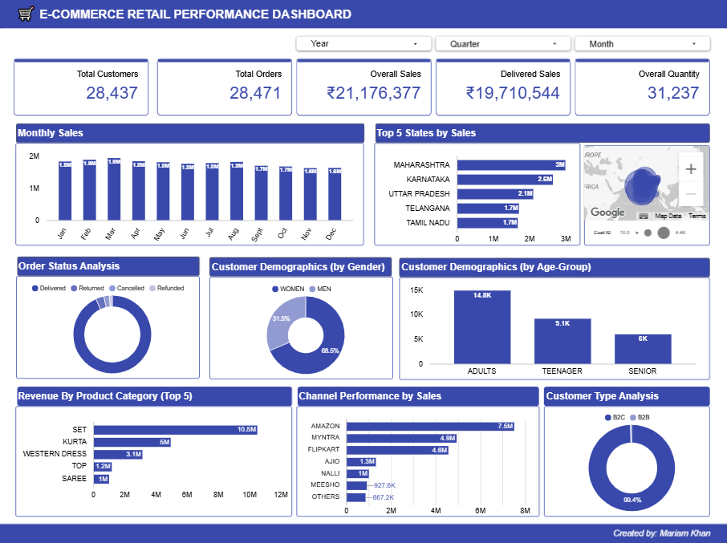
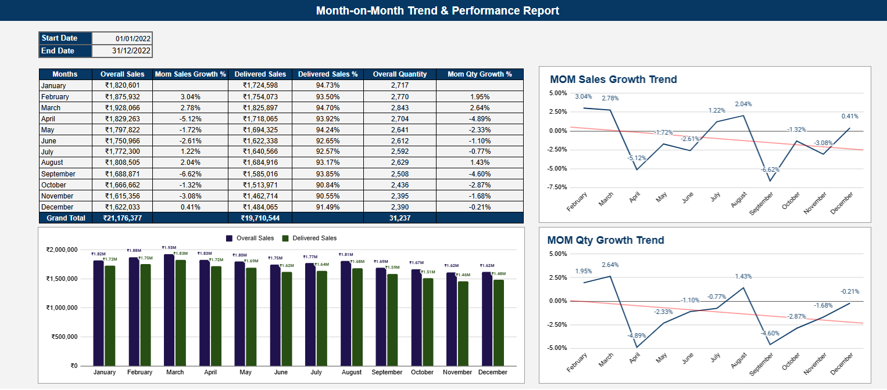
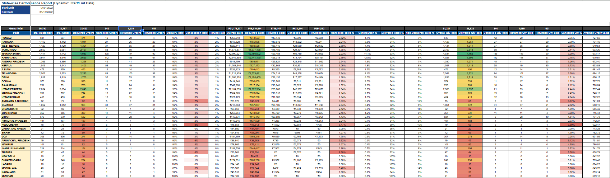
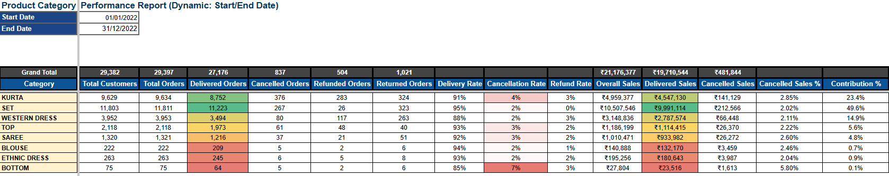
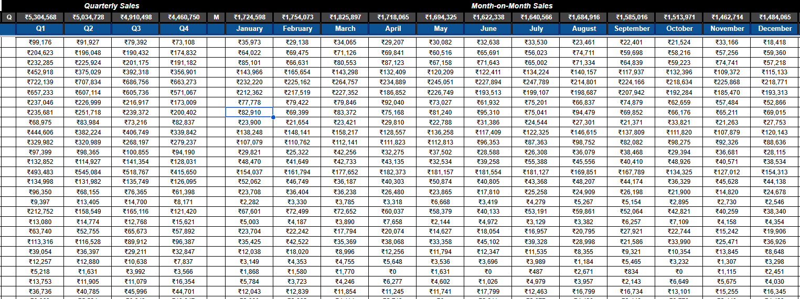

# E-Commerce Retail Data Analysis & Management Reporting

An Excel/Google Sheets-based retail analytics case study focused on
transforming transaction-level e-commerce data into KPI reporting, trend
analysis, dynamic date-range reports, and evidence-based management
recommendations.

## Project Overview

The business scenario represents a multi-channel fashion retailer
selling through online marketplaces and serving both B2C and B2B
customers.

The objective was to prepare the raw data, define meaningful business
KPIs, analyse sales and fulfilment performance, and communicate findings
that management could use to investigate business risks and
opportunities.

> **Implementation note:** The analysis was developed in Google Sheets.
> Google Sheets is the primary working version; formulas and dynamic
> behaviour may not transfer identically if the workbook is exported to
> Microsoft Excel.

## Project Components

The workbook contains the following reporting areas:

1.  **Raw Data** --- original transaction data preserved without
    destructive edits.
2.  **Working File** --- prepared dataset with standardized text fields
    and derived date dimensions.
3.  **KPIs Report** --- overall sales, delivered sales, orders,
    customers, quantities, and fulfilment-status measures.
4.  **MoM Trend Analysis Report** --- monthly sales performance and
    month-on-month comparisons.
5.  **Management Report** --- answers to ten management questions,
    executive summary, insights, and recommended actions.
6.  **Dynamic Reports** --- date-range-driven analysis by state, city,
    gender, age group, channel, product category, size, order status,
    and customer type (B2B/B2C).

Each dynamic report has Start Date and End Date inputs. The current
reporting period is 1 January 2022 to 31 December 2022.

## Tools and Techniques

-   Google Sheets
-   Data cleaning and standardization
-   Date dimension derivation: year, quarter, month, month number, week,
    day, and numeric day
-   `SUMIFS` and `COUNTUNIQUEIFS`
-   KPI definition and validation
-   Month-on-month trend analysis
-   Dynamic date-range reporting
-   Business interpretation and management recommendations

## Dataset Snapshot

The source dataset contains **31,047 transaction lines**.

| Measure | Reported value |
|---|---:|
| Distinct orders | 28,471 |
| Distinct customers | 28,437 |
| Overall sales | ₹21,176,377 |
| Delivered sales | ₹19,710,544 |

The dataset contains four order statuses: Delivered, Returned,
Cancelled, and Refunded.

## Key Business Insights

-   **Fulfilment leakage:** ₹1.47M, or 6.92% of sales, was not
    delivered. Returns accounted for ₹719,147, approximately 49% of this
    non-delivered value.
-   **Category-level opportunity:** Western Dress represented 14.9% of
    sales but 28.4% of returned value. Kurta represented 23.4% of sales
    and 44.9% of refunded value.
-   **Sales concentration:** SET contributed approximately 49.6% of
    sales. Amazon, Myntra, and Flipkart together contributed about 80%,
    while the top five states contributed about 53%.
-   **Trend to investigate:** the delivered share of monthly sales
    declined from 94.7% in January to 90.6% in November.
-   **B2B opportunity:** B2B contributed approximately 0.6% of sales
    while showing a reported delivery rate of about 95%, compared with
    about 93% for B2C.

## Recommended Management Actions

1.  Investigate returns for Western Dress and Kurta, including size/fit
    guidance, product descriptions and images, and quality checks.
2.  Review fulfilment with logistics partners in Maharashtra, Karnataka,
    and Telangana, and monitor states where non-delivered sales exceed
    8%.
3.  Reduce concentration risk by developing additional sales channels,
    testing B2B growth opportunities, and exploring targeted upselling
    for customer segments with higher average order value.

## Data Preparation and Limitations

-   The Raw Data tab is preserved; preparation was performed in the
    Working File.
-   Unneeded fields were excluded from the prepared reporting dataset,
    and field names were standardized.
-   Common city spelling variants were merged, including Bangalore to
    Bengaluru, Allahabad to Prayagraj, and Gurgaon to Gurugram.
-   Delhi and New Delhi were retained as separate values, following the
    analysis decisions for this case.
-   Customer and order KPIs use distinct counts rather than
    transaction-row counts.
-   Group-level totals may sum distinct counts calculated within each
    group; an order or customer represented in multiple groups can
    therefore be counted in more than one group total.
-   The dataset contains only **36 unique dates**---roughly three dates
    per month. Monthly and weekly trends therefore reflect the available
    dates, not a complete daily record of the year. This limitation
    should be considered when interpreting trends.

## Repository Contents

Suggested repository structure:

``` text
E-Commerce-Retail-Data-Analysis/
├── assets/
├── README.md
└── Management_Report.md
```

The files above document the project and its requirements. The working
analysis remains in Google Sheets.

### Open the Google Sheets workbook

[Google Sheets workbook link](https://docs.google.com/spreadsheets/d/1n6-C8iIL07yZ9GrKuJOxfx9aOxNRSwJGye5WyQzUXwU/edit?usp=sharing)

[Live Dashboard Link](https://datastudio.google.com/reporting/f5a22949-0ee2-417f-801c-2e1e02157409)

### Screenshots



  



## Purpose

This case study demonstrates an end-to-end reporting workflow: preparing
data, defining business measures, building dynamic reports, analysing
trends, and translating findings into actionable management
recommendations.

## Credits & Ownership

**Mariam Khan**

[LinkedIn](https://linkedin.com/in/mariam-khan0424) · [GitHub](https://github.com/mariamkhan04)

This project was completed as part of the **AI DataYard's BI Bootcamp**.